# RAGEval — RAG 系统自动化评测工具

基于 LLM-as-Judge 的 RAG 评测工具，参考 [RAGAS](https://github.com/explodinggradients/ragas) 的指标口径，面向「能安全跑长任务、结果可交付」的场景。

## 架构

```mermaid
flowchart LR
    D[评测数据集<br/>question / answer / contexts / tags] --> E[EvaluationEngine]
    E --> M[四指标<br/>LLM-as-Judge]
    M --> L[LLMClient<br/>限流 / 重试 / 缓存]
    L --> C[(SQLite 响应缓存)]
    E --> K[(JSONL 断点)]
    E --> R[JSON + HTML 报告]
    E --> T[按标签汇总]
    CLI[python -m ragas_eval] --> E
    CMP[compare] --> R
```



## 功能

- **四个核心指标**：Faithfulness / Answer Relevancy / Context Precision / Context Recall
- **位置加权精确度**：Context Precision 采用 Average Precision 口径，相关段落排得越靠前得分越高
- **可靠执行**：`asyncio.Semaphore` 限流、指数退避重试（429/5xx/超时）、60s 超时、JSON 解析失败自动修复一次
- **断点续跑**：每条样本完成即写入 JSONL，中断后重跑自动跳过已完成样本
- **响应缓存**：以 `(model, messages, temperature)` 哈希为 key 落盘 SQLite，重复评测不重复计费；非 0 温度的采样请求不落缓存，避免多次采样命中同一响应
- **失败与不适用分开统计**：指标解析失败记 `score=None` 并计入 `failed_count`；纯拒答没有事实性陈述，Faithfulness 记 `skipped=True`，不计入均值也不计入失败
- **多次采样**：`--samples N` 让每个指标重复评测 N 次，首轮 T=0、其余按 `SAMPLE_TEMPERATURE` 采样，输出样本级均值/σ 与指标级 `sampling_std`；每次采样的理由一并落盘，便于定位方差来源
- **可交付报告**：JSON + 自包含 HTML（雷达图、分数分布、最差样本 Top 10 钻取）
- **分层评测**：样本可打难度标签（`normal` / `boundary` / `adversarial`）与领域标签（`hotpotqa` / `policy`），报告按标签聚合指标，区分常规质量与边界/对抗表现
- **A/B 对比**：输出两版 RAG 系统的指标差值，以及逐样本胜/平/负
- **端到端接入**：附带 `scripts/run_dify_system.py`，按样本标签路由到 Dify Chat App，直接采集系统回答与 `retriever_resources` 作为 `answer` / `contexts`
- **CI 质量门禁**：`--fail-under` 未达标时退出码 1；GitHub Actions 跑离线测试，配置 Key 后额外跑小样本评测回归
- **成本可观测**：token、调用次数、缓存命中、重试次数、预估费用写入报告

## 快速开始

```bash
python -m venv .venv
# Windows
.venv\Scripts\activate
# macOS / Linux
source .venv/bin/activate

pip install -r requirements.txt
cp .env.example .env        # Windows: copy .env.example .env
# 编辑 .env，至少填写 OPENAI_API_KEY
```

```bash
# 跑评测
python -m ragas_eval run --dataset data/eval_dataset.json --system-version v1

# 只跑部分指标、调高并发
python -m ragas_eval run --dataset data/eval_dataset.json \
  --metrics faithfulness,context_recall --max-concurrency 8

# 中断后直接重跑同一条命令，会从断点继续
```

## CLI

```text
python -m ragas_eval run --dataset <json> [options]
  --output-dir results        报告输出目录
  --metrics a,b              逗号分隔的指标名
  --max-concurrency 5        同时评测的样本数
  --samples 1                每个指标重复采样次数（3 适合稳定性分析）
  --threshold 0.6            低分样本阈值
  --system-version v1        被测 RAG 系统版本（写入报告）
  --tags normal,adversarial  只评测含指定标签的样本
  --limit 3                  只评测过滤后的前 N 条（CI 冒烟）
  --fail-under 0.5           最低指标均分低于该值时退出码 1（CI 质量门禁）
  --no-resume                忽略断点，从头评测
  --no-html                  只输出 JSON
  --no-cache                 禁用响应缓存

python -m ragas_eval rejudge --report results/a.json --metrics context_recall [options]
  --output-dir results/rejudge  重判报告输出目录
  --metrics context_recall      只重判指定指标
  --system-version v1           覆盖报告中的被测系统版本
  其余参数与 run 一致（--samples / --max-concurrency / --no-html / --no-cache）

python -m ragas_eval compare results/a.json results/b.json [--json]
```

`rejudge` 从已有报告的 `detailed_results` 还原问答与上下文，用当前指标版本重算指定指标；输出报告只包含重判的指标，`metadata.rejudged_from`、`rejudged_metrics` 与 `source_metric_versions` 记录来源。更换指标实现或 judge 后，用它重算旧报告，避免直接拿旧分数和新口径比。重判的长 JSON 输出可能超过默认 60 秒请求超时；失败样本计入 `failed_count`，用 `REQUEST_TIMEOUT=180` 重跑时成功样本会命中缓存、只补失败项（本次 CR v2 重判的 7 条超时即按此补齐）。

## 数据集格式

```json
[
  {
    "question": "用户问题",
    "answer": "RAG 系统生成的回答",
    "contexts": ["检索到的上下文片段1", "片段2"],
    "ground_truth": "标准答案（用于计算召回率）",
    "tags": ["boundary", "policy"],
    "note": "版本冲突：应按最新版本回答"
  }
]
```

`tags` 可选，可写多个标签：难度标签用 `normal` / `boundary` / `adversarial`，领域标签用 `hotpotqa` / `policy`；报告按每个标签分别聚合（同一条样本会出现在多个分组中），不写则归入 `untagged`。`--tags` 是并集语义，如 `--tags normal,hotpotqa` 会选中所有命中任一标签的样本。

`note` 可选，用于记录该样本的考察点与预期行为，不参与指标计算。

`answer` 为空时可用 `python scripts/generate_answers.py --dataset data/eval_dataset.json` 自动生成（会消耗 LLM 额度）。

## 分层评测与 CI

`data/eval_dataset.json` 是 41 条中英双语分层评测集：25 条 `normal`（20 条 HotpotQA + 5 条中文制度问答）、8 条 `boundary`、8 条 `adversarial`。

- `boundary`：零上下文拒答、超长安全制度、制度版本冲突、条件型奖金、年假年限临界、加班时长取整、福利适用范围、年假跨年例外
- `adversarial`：上下文注入、高置信数字陷阱、检索噪声淹没、评分指令注入、虚假前提纠错（同主题直接提问的对照）、缺失信息陷阱

```bash
# 只跑正常层的前 3 条，并启用质量门禁（适合 CI 回归）
python -m ragas_eval run --dataset data/eval_dataset.json \
  --tags normal --limit 3 --fail-under 0.5
```

HTML 报告会按标签聚合指标，最差样本列表带层标签，便于区分「常规回归」与「对抗鲁棒性」。

`.github/workflows/ci.yml`：

- push / PR 在 Python 3.11、3.12 下跑全部离线测试
- 配置 `OPENAI_API_KEY`（可选 `OPENAI_BASE_URL`、`JUDGE_MODEL`）secret 后，push 额外跑 normal 层前 3 条样本的评测并上传报告，最低指标均分低于阈值时任务失败

## 端到端系统评测（Dify）

`scripts/run_dify_system.py` 把真实 RAG 系统的输出变成评测数据集：按样本标签路由到对应 Dify Chat App，采集 `answer` 与 `retriever_resources` 作为 `contexts`。

```bash
# 1. 生成系统输出（41/41，调用失败会记录并单独报告）
python scripts/run_dify_system.py --dataset data/eval_dataset.json \
  --output data/system_dify_v1_k8hot.json --apps-file /path/to/dify-apps.json

# 2. 对系统输出跑四指标
python -m ragas_eval run --dataset data/system_dify_v1_k8hot.json \
  --system-version dify-1.18.0-bge-m3-policy4-hotpotqa8 --output-dir results/system_dify_v1_k8hot
```

`--apps-file` 放在仓库外，内容为 `{"base_url": "http://localhost:8080", "apps": {"policy": {"api_key": "...", "app_id": "..."}, "hotpotqa": {...}}}`，API Key 不进版本库。

实测环境：Dify 1.18.0 自托管（Weaviate）+ 本地 BGE-M3 embedding 服务 + `deepseek-v4-pro`（OpenAI 兼容插件），`semantic_search`、无 rerank；policy 与 hotpotqa 各一个 Chat App，预提示要求只依据检索上下文回答、无依据时明确拒答。2026-10-31 的单次端到端跑批使用 **policy `top_k=4` + hotpotqa `top_k=8`**，旧的全量 k=4 结果保留作对照。

同一 judge（`deepseek-v4-pro-0813`）判分后的对比（新系统报告：`results/system_dify_v1_k8hot/eval_report_20261031_154814_final.json`；Context Recall 为 `relation-v2` 重判结果，其余指标沿用原报告）：

| 指标 | 参考答基线 | 旧 Dify k=4 | 新 Dify（policy 4 + hotpotqa 8） | 新-基线 | 有效样本（基线/旧/新） |
|---|---|---|---|---|---|
| Faithfulness | 0.983 | 0.988 | 1.000 | +0.017 | 40 / 35 / 37（跳过 1 / 6 / 4） |
| Answer Relevancy | 0.502 | 0.647 | 0.656 | +0.154 | 41 / 41 / 41 |
| Context Precision | 0.611 | 0.819 | 0.821 | +0.210 | 40 / 41 / 41 |
| Context Recall（relation-v2） | 0.967 | 0.793 | 0.866 | -0.101 | 41 / 41 / 41 |

- 参考答基线使用数据集的参考答与参考上下文（参考答均为修正后的正确答案；零上下文的宠物题 CP 无法计算，不计入均值）。参考上下文含 HotpotQA 干扰段，因此基线的 Context Precision 偏低，不能当作检索上界。
- Faithfulness 的 1.000 是 37 条可作答样本全部 1.0，已饱和，不代表回答质量完美。4 条跳过为 hotpotqa 2 条（Big Stone Gap、Guns N' Roses）与 policy 2 条（带宠物、带薪病假）。对 37 条公共样本配对，新系统 1 胜 36 平 0 负，平均差 +0.009，可作答样本上与基线基本持平；旧 k=4 的 6 条跳过含 4 条 hotpotqa 拒答、2 条 policy 拒答。此前「系统低 0.095、生成侧过度推断」的结论，主要是把英文拒答句误当成 claim 后随机判 0 造成的假差距，不是真实的生成缺陷。
- Answer Relevancy 新系统 0.656，相对基线 +0.154（26 胜 6 平 9 负，+0.1538），相对旧 k=4 仅 +0.009（14 胜 13 平 14 负，+0.0089）。系统答案更短、更贴问题，而参考答信息冗余；绝对值仍偏低，主要被 hotpotqa 拒答与部分拒答题拉低（hotpotqa 组 0.576、normal 组 0.603）。人工校准显示该指标对短答与拒答系统性偏低（见“首轮校准结果”），0.656 不能直接解读为人工感知的相关性。
- Context Precision 0.821，相对基线 +0.210（40 条可配 19 胜 18 平 3 负，+0.2301）；相对旧 k=4 +0.002（2 胜 36 平 3 负，+0.0016），policy 部分基本不变。
- Context Recall 0.866（`relation-v2`），相对基线 -0.101（41 条 0 胜 36 平 5 负）。基线仍是 0.967：参考上下文本身明确陈述了“GNR 为《End of Days》做宣传”“WINNER 由 YG Entertainment 成立”这类关系，v2 与 v1 的 41 条完全一致，说明下降不是口径一律变严。系统侧的 5 条下降为：GNR 1→0（k=8 只分散出现 “1999” 与 “Guns N' Roses”，没有宣传关系）、2014 S/S 1→0（专辑由 YG 发行 ≠ 组合由 YG 成立）、Big Stone Gap 0.5→0（只有 “New York City”，没有 Greenwich Village）、携带宠物 1→0（GT 是“知识库没有该制度”的否定式答案，缺失上下文无法证明否定）、实习医保 1→0.5（上下文只说正式员工可享，没有明说实习生不可）。David Beckham 与 Vermont 仍为 1.0；Beckham 由“Ferguson 1986–2013 执教”与“1995–96 赛季启用 Beckham”两段拼成完整关系，说明跨段证据链可用。CR v2 消除了“关键词出现即覆盖”的假阳性，但否定式 GT 与隐含否定会引入假阴性（见“首轮校准结果”）。
- 新系统与旧 k=4 的差值为 +0.012 / +0.009 / +0.002 / +0.024。本轮 policy 与 hotpotqa 答案都重新生成，差值包含生成随机性，不完全是 top_k 的因果效应；k=4→k=8 的消融结论以同问题集、同基线的下节配对表为准。
- 2026-10-30 数据修订：5 道 HotpotQA yes/no 题的 `ground_truth` 由单字扩写为事实句（`answer` 不变），Context Recall 不再因单字 GT 抖动。这使 CR 在此前报告基础上整体上移（v1 口径：基线 0.870→0.967、旧 k=4 系统 0.817→0.939）。2026-10-31 又统一按 `relation-v2` 重判，当前可比数字为基线 0.967、旧 k=4 0.793、新系统 0.866；旧报告的 v1 CR 不可与新数字直接横比。
- 旧 k=4 系统在 hotpotqa 20 题中有 5 题宽口径拒答：Animorphs、Guns N' Roses、Vermont、Big Stone Gap、2014 S/S。Brown State 原题的 country/county 表述已修正，修正后 k=4 即可答出 9,984，不再计入拒答。
  - Animorphs：正面证据排第 1，拒答属于生成/提示词问题；
  - Guns N' Roses：直接证据（《Oh My God》单曲页写明 1999 年为《End of Days》原声宣传）需要 `top_k=10` 才召回。k=8 的回答是“电影为 *End of Days* (1999)，但知识库未说明 GNR 做宣传”的保留式回答，并非答出 1999；全量复跑时该题变为纯拒答。此前把该题的 CR=1.0 当作“证据已召回”是误读（按关系级标准是假阳性）：CR 只检查标准答案要点 “1999” 是否出现，不检查“GNR 为该片做宣传”这一关系；该题不属于生成侧不稳定；
  - Vermont：所需会议段落排第 8，`top_k=4` 漏掉，`top_k≥8` 可覆盖；
  - Big Stone Gap：所需事实（导演常驻的 Greenwich Village）在 top-10 内完全没有召回，属于语料/embedding 漏检；
  - 2014 S/S：k=4 只答出 YG Entertainment 并拒绝回答成立者，k=8/10 曾退化为完整拒答。
- k=8 的消融运行让 Animorphs 答出、Vermont 可答，Guns N' Roses 只给出“知识库未说明宣传关系”的保留式回答，并非答出 1999；2026-10-31 的全量复跑时该题变为纯拒答。该题的 CR=1.0 在关系级标准下是假阳性：k=8 的 8 段上下文只分散出现 “1999” 与 “Guns N' Roses”，没有任何一段说明 GNR 为该片做宣传；k=10 才召回《Oh My God》单曲页并答出 1999。因此不能把该题归因于生成侧不稳定。Animorphs、Vermont 复跑保持可答，Big Stone Gap 仍召回不到。k=8 是覆盖与噪声的折中，但不能说它修复了 Guns N' Roses。
- 检索诊断见 `results/system_dify_v1/retrieval_diagnostic.json`（39/41 至少召回一段参考证据）与 `results/system_dify_v1/topk_probe.json`。覆盖扫描（hit-testing，不调用 LLM；参考段落被结果以 Jaccard≥0.5 命中即算覆盖）：

| 领域 | top_k=4 | top_k=6 | top_k=8 | top_k=10 |
|---|---|---|---|---|
| policy 平均参考段落覆盖率 | 0.652 | 0.735 | 0.752 | 0.802 |
| hotpotqa 平均参考段落覆盖率 | 0.405 | 0.565 | 0.715 | 0.800 |

policy 在 k=6 后增幅收窄（k=6→8 仅 +0.017），k=10 仍有小幅提升；hotpotqa 随 k 单调上升。k=8 的覆盖增益能救回 Vermont 这类漏段题，但 Big Stone Gap 在 top-10 外仍未覆盖，Guns N' Roses 需要 k=10 才召回关系证据，因此覆盖率不是回答质量的唯一决定因素。

### top_k 消融（hotpotqa 20 条）

同一 judge、同一问题集，policy 保持 k=4，只调整 hotpotqa：

| top_k | Faithfulness | Answer Relevancy | Context Precision | Context Recall（v2） | 严格拒答 | 平均上下文数 |
|---|---|---|---|---|---|---|
| 4（基线） | 0.984 | 0.513 | 0.729 | 0.700 | 4/20 | 4 |
| 8 | 1.000 | 0.572 | 0.732 | 0.850 | 2/20 | 8 |
| 10 | 1.000 | 0.519 | 0.729 | 0.850 | 2/20 | 10 |

（Faithfulness 按拒答口径跳过纯拒答：k=4 有效 16 条、跳过 4 条；k=8/k=10 有效 18 条、跳过 2 条。Context Recall 为 `relation-v2` 重判结果，v1 分别为 0.925 / 0.975 / 0.975。）

- k=8 是拐点：按 `relation-v2`，Context Recall 从 k=4 的 0.700 升到 0.850（+0.150，3 胜 0 负 17 平）。3 条提升为 Animorphs、Vermont、Henry Roth/Childers（k=4 时关系未被单段支持，k=8 召回完整证据）；k=8 仍有 3 条为 0：GNR（8 段只有分散的 1999 与 GNR，没有宣传关系）、2014 S/S（专辑由 YG 发行 ≠ 组合由 YG 成立）、Big Stone Gap（始终召回不到 Greenwich Village）。Context Precision 基本不变（+0.003）。GNR 在 k=10 才召回《Oh My God》单曲页并判 1.0，因此 k=8 的 v1 CR=1.0 是关系级假阳性，不能据此认为证据已召回。
- Faithfulness 在 k=8/k=10 已饱和：18 条可作答样本全部为 1.0，k=4 的 0.984 也只有一条 0.75。此前「k=8 让 Faithfulness +0.120」并非检索改善了事实支撑，而是 k=4 的纯拒答被随机判 0/0.333；改用拒答跳过口径后，15 条两边都可判定的公共样本配对平均仅 +0.017（1 胜 14 平 0 负）。
- k=10 与 k=8 同为 F 1.000、CR 0.850，但构成不同：k=10 的 GNR 由 0 升到 1.0（召回《Oh My God》单曲页），Aladin 却由 1.0 降到 0（上下文没有给出可引用的关系证据）；其余 18 条相同。Answer Relevancy 从 0.572 回落到 0.519，2014 S/S 从部分拒答变成完整拒答，Big Stone Gap 仍召回不到。k=10 的关系证据收益与噪声损失相互抵消，按当前指标 k=8 的综合表现更稳。
- 逐样本配对（k=8 vs k=4，20 条）：Context Recall（v2）3 胜 0 负 17 平；Answer Relevancy 8 胜 6 负 6 平；Context Precision 2 胜 3 负 15 平；Faithfulness 在 15 条公共可判样本上 1 胜 0 负 14 平。k=10 vs k=8 的 CR 为 1 胜 1 负 18 平。judge 噪声明显，不宜过度解读单个指标的小幅变化。
- 成本：Dify 生成 token 19,081 / 29,264 / 34,548。k=8、k=10 首轮 judge 用量分别约 162k / 145k tokens；yes/no GT 扩写后只重判 5 条 CR（k=8 7.9k、k=10 10.0k tokens），其余命中缓存；拒答口径重判只涉及 k=8/k=10 各 2 条纯拒答，零额外调用。
- 工程结论：该知识库与模型组合下 hotpotqa 的默认点选 k=8，兼顾覆盖与噪声；k=10 能召回 Guns N' Roses 的关系证据，但会牺牲 2014 S/S 并使 AR 回落，是否值得取决于更看重哪类题。另需注意 Dify 1.18 实际生效的检索深度取 app 的 `dataset_configs.top_k` 与数据集 `retrieval_model.top_k` 的较小值，只改数据集不会生效。
- 单次端到端复跑（2026-10-31，policy k=4 + hotpotqa k=8，41 条一次生成）：Faithfulness 1.000（37 有效、4 跳过）/ Answer Relevancy 0.656 / Context Precision 0.821 / Context Recall 0.866（relation-v2），相对参考答基线 +0.017 / +0.154 / +0.210 / -0.101。hotpotqa 子集为 F 1.000（18 有效、2 跳过）/ AR 0.576 / CP 0.733 / CR 0.850（v1 为 0.975），与上表 k=8 消融的 0.850 相同（两处使用同一批检索上下文）；文档不再使用按领域拼接的合并口径。
- 成本：本轮 Dify 生成 41,277 tokens（41 次调用，平均 4.3s/条）；judge 主判分 145,849 tokens（107 次调用、329 次缓存命中、2 次重试），补判 14,915 tokens，判分耗时 862.4s。缓存命中部分不计费。CR v2 重判另消耗约 517k judge tokens：k8 全量 145k（首次有 7 条 60 秒超时，补跑 34 条命中缓存、7 条实时调用）、基线 185k、旧 k4 79k、k8 消融 0（20 条全部命中缓存）、k10 107k。

## 指标口径

| 指标 | 计算方式 | 衡量 |
|---|---|---|
| Faithfulness | 被上下文支持的 claim 数 / claim 总数；纯拒答没有可验证 claim，记为跳过 | 生成是否有幻觉 |
| Answer Relevancy | 由回答反推 3 个问题，与原问题求平均相似度（配置 `EMBEDDING_MODEL` 时用 embedding 余弦，否则由 LLM 批量打分） | 回答是否切题 |
| Context Precision | `AP = Σ_{k: 相关} (前 k 段命中数 / k) / 相关段数` | 检索排序质量 |
| Context Recall | 关系级覆盖：被上下文完整支持的要点数 / 标准答案要点总数；要点必须由同一段或相邻句明确陈述实体、关系和结论，关键词分散出现不算覆盖 | 检索是否漏信息 |

任何一步解析失败返回 `score=None`，不计入均值；报告里通过 `failed_count` 单独统计。

Context Recall 当前版本为 `relation-v2`，报告 `metadata.metric_versions` 记录各指标版本。v2 之前的 CR（v1，要点关键词出现即算覆盖）与 v2 不可直接横比。2026-10-31 用 `rejudge` 统一重判：基线 0.967（41 条与 v1 完全一致，参考上下文明确陈述关系）、k8 全量 0.963→0.866、旧 k4 0.939→0.793、k8/k10 消融 0.975→0.850；汇总见 `results/rejudge/cr_v2_summary.json`。回归样例：`C19`（Guns N' Roses）k=8 的 1.0→0.0（只有分散的 1999 与 GNR，没有宣传关系），2014 S/S 1.0→0.0（专辑由 YG 发行 ≠ 组合由 YG 成立），k=10 的 GNR 为 1.0（《Oh My God》页明确写了 promo），David Beckham 跨段证据链为 1.0。

拒答与失败分开处理：

- **纯拒答**（如 “I cannot find it in the knowledge base.”）不含事实性陈述，Faithfulness 记 `score=None, skipped=True`，不计入均值、也不计入 `failed_count`；汇总记 `skipped_count`，多次采样时另记 `skipped_draws`
- **部分拒答**（先说明知识库没有 X，再回答有依据的部分）先按句过滤拒答/元陈述，只对有事实内容的句子抽 claim 并验证；被过滤的句子写入 `filtered_sentences`
- 这样同一句拒答不会因为被误抽成 claim 而在 0 与 1 之间跳变；拒答率由 Answer Relevancy、Context Recall 和人工复核观察，不塞进 Faithfulness
- 多次采样时 `sample_reasons` 保留每次采样的分数与理由，HTML 报告可逐次展开查看

## 多次采样与稳定性

单次 judge 调用带采样随机性，边界样本的分数可能跳动。`--samples N` 让每个指标对同一条样本重复评测 N 次：

- 第 1 次使用 `temperature=0`，与历史单次口径一致；其余 N-1 次使用 `SAMPLE_TEMPERATURE`（默认 `0.7`）
- 样本分数取 N 次均值，样本级离散度写入 `score_std`；指标汇总追加 `sampling_std`（各样本 σ 的均值）
- `σ` 为总体标准差（除以 N），不是样本标准差（N-1）；`sample_scores` 保留 3 位小数用于展示，均值与 σ 由原始分数计算
- 某次采样调用失败时，均值只用成功次数；只有 1 次有效时 `score_std` 记 `None`（不按 0 处理），汇总额外记录 `sampling_std_samples`、`partial_failures` 与 `failed_draws`
- 非 0 温度请求不读写响应缓存：否则第 3 次采样会命中第 2 次的缓存，σ 恒为 0。代价是 `--samples 3` 的实际消耗约为单次的 2–3 倍
- 默认 `samples=1`，与本文档已发布的单次评测数字保持同口径；需要稳定性结论时显式开启
- 断点文件带 `_sN` 后缀，避免与单次评测混用；报告元数据的 `sampling` 字段记录次数与温度序列

```bash
python -m ragas_eval run --dataset data/system_dify_v1.json \
  --samples 3 --system-version dify-1.18.0-bge-m3-top4-s3
```

### 实测：hotpotqa 20 条 × 3 次

2026-10-31 在 Dify 系统（k=4）的 hotpotqa 子集上跑 3 次采样。该表是 20 条子集结果，不可与上面 41 条全量数字直接比较：

| 指标 | 单次（T=0） | 3 次均值 | 差值 | `sampling_std` | 可估样本 |
|---|---|---|---|---|---|
| Faithfulness | 0.984 | 0.974 | -0.010 | 0.015 | 16/20（跳过 4） |
| Answer Relevancy | 0.513 | 0.503 | -0.010 | 0.055 | 19/20 |
| Context Precision | 0.729 | 0.749 | +0.020 | 0.037 | 20/20 |
| Context Recall（v1） | 0.925 | 0.925 | 0.000 | 0.000 | 20/20 |

该次采样运行时 CR 还是 v1 口径；v2 未在这批 3 次采样上重跑，表中的 CR 稳定性只对 v1 成立。

- 首轮 T=0 的 Faithfulness 均值为 0.984，与单次报告一致；AR/CP/CR 的 60 个单元也全部与历史单次报告一致。非 0 温度的第 2/3 次中，非 F 指标有 19/60 个单元结果不同，确认采样请求没有被缓存复用
- 75 个可估单元中 17 个 σ>0，最大 σ 0.471（Context Precision 的 Animorphs 三次为 0/1/1）；单次分数仍不足以代表这类边界样本的稳定水平
- Faithfulness 的方差从旧口径的 σ 0.050 降到 0.015：4 条纯拒答不再随机判 0/1，只剩 2014 S/S 一条部分拒答在 1.0/0.5/1.0 之间波动（σ 0.236）
- 本次运行有 4 个单元、共 5 次采样因超时或服务端 500 缺次（AR 3 个单元 4 次，CP 1 个单元 1 次）；其中 1 个单元仅 1 次有效，σ 记 N/A 且不参与 `sampling_std`。失败只影响该次采样，不改变已有分数
- 该验证消耗约 360k judge tokens：原始采样 322k（339 次调用、175 次缓存命中，耗时约 28 分钟）+ 拒答口径重判 37.6k（12 次调用、0 失败）；3 次均值相对单次的变化在 ±0.020 内，引用时需注明口径

### 边界样本：`--samples 3` 重复的是 judge，不是生成

从这次采样里挑 3 道检索证据明确的 HotpotQA 题，看同一份回答被重复判分的结果（`results/sampling_dify_hotpotqa_k4/_boundary_examples.json`）：

| 样本 | Faithfulness | Answer Relevancy（σ） | Context Precision | Context Recall（v1） |
|---|---|---:|---:|---:|
| David Beckham / 弗格森执教曼联时间段 | 1.0 / 1.0 / 1.0 | 0.767 / 0.367 / 0.000（0.313） | 0.75 / 0.75 / 0.75 | 1.0 / 1.0 / 1.0 |
| 2014 S/S 所属组合由谁成立 | 1.0 / 1.0 / 1.0 | 0.750 / 0.867 / 0.600（0.109） | 1.0 / 1.0 / 1.0 | 1.0 / 1.0 / 1.0 |
| Random House Tower / 888 7th Avenue | 0.6 / 失败 / 失败 | 0.950 / 0.700 / 0.867（0.104） | 1.0 / 1.0 / 1.0 | 1.0 / 1.0 / 1.0 |

- 三道题的系统回答在三次采样中完全不变；`--samples 3` 只重跑 judge 打分，不重新生成回答。因此表中的 AR 波动是**判分器不稳定性**，不是生成波动
- David Beckham 题的回答固定为 “1986 to 2013.”，证据分别在《Alex Ferguson》（1986–2013）与《1995–96 Manchester United season》（引进了 Beckham）两段里；AR 从 0.767 掉到 0，说明短答的反推问题方法对同一事实也可能给出完全相反的结果
- 2014 S/S 题的回答明确说“知识库没有说明由谁成立”，但 CR v1 仍给 1.0：上下文只写了专辑由 YG Entertainment 发行，没有写组合由 YG 成立。这是继 `C19` 之后第二个关系级假阳性，v2 重判为 0.0；同表的 David Beckham 与 Random House 在 v2 下仍为 1.0
- 要测生成稳定性，需要重新调用被测 RAG 系统生成多份回答，再逐份判分；当前 `--samples` 不覆盖这一步

## 人工校准

LLM judge 的绝对分需要人工抽检支撑。`scripts/calibrate_judge.py` 从一份评测报告里做**目的抽样**，生成不显示 judge 分数的盲评页面，再把人工 1–5 分与 judge 0–1 分配对，计算 Spearman 秩相关与二分类 Cohen's Kappa。

```bash
# 1. 生成 25 条盲评表（默认 seed=20261031，可复现）
python scripts/calibrate_judge.py make \
  --report results/system_dify_v1_k8hot/eval_report_20261031_154814_final.json \
  --output-dir results/calibration

# 2. 浏览器打开 calibration_sheet.html，逐条评分并导出 JSON

# 3. 计算一致性报告（Markdown + JSON）
python scripts/calibrate_judge.py score \
  --ratings results/calibration/calibration_ratings_<时间戳>.json \
  --key results/calibration/calibration_key.json \
  --output results/calibration/calibration_report.md
```

- 抽样规则：按标签配额（normal_policy 5 / normal_hotpotqa 8 / boundary 6 / adversarial 6），**全部纯拒答强制入样**，其余优先覆盖 AR/CP/CR 的低（<0.5）、中（<0.85）、高分段。这是低分富集样本，**不能用来估计总体均值或通过率**。
- 盲评页只显示问题、系统回答、检索上下文和标准答案；judge 分数在 `calibration_key.json` 里，评分完成前不要打开。
- 页面用 `localStorage` 自动保存，导出的 JSON 带 `sheet_id`；计分时会校验 `sheet_id`，旧抽样表的评分不会被误用于新样本。
- 评分标准：每个指标 1–5 分或 N/A（标准见 `calibration_rubric.md`）。纯拒答的 Faithfulness 记 N/A；纯拒答的 Answer Relevancy 按“没有回答问题”给低分。
- 统计口径：Spearman 用平均秩处理并列，p 值为 2000 次置换检验；Kappa 按 judge ≥0.6 二分，人工通过线按指标配置：**F/AR ≥3、CP/CR ≥4**（CP/CR 的 3 分是“部分满足”，默认不算通过）。报告同时输出人工线 ≥3 / ≥4 的阈值敏感性表；需要全局覆盖时用 `--human-pass 3`，按指标覆盖用 `--human-pass-map context_precision=4,context_recall=4`。某一方无方差时 Spearman / Kappa 显式记为不可估，不用 0 代替。
- 已知局限：单评分人，无评分者间信度；当前 k=8 报告的 37 条可作答样本 Faithfulness 全为 1.0，F 的 Spearman 不可估，只能看一致率与假阳性样本。

### 首轮校准结果（25 条，2026-10-31）

对 `dify-1.18.0-bge-m3-policy4-hotpotqa8` 的报告抽 25 条盲评，报告见 `results/calibration/calibration_report.md`。判定阈值：judge ≥0.6；人工通过线按指标配置（F/AR ≥3、CP/CR ≥4），阈值敏感性见报告。CR 已用同一批人工评分按 `relation-v2` 重算（只替换 CR judge 分数，不是新一轮独立人工校准），结果见 `results/calibration/calibration_report_cr_v2.md`。

| 指标 | 人工阈值 | 可配对 n | Spearman ρ（置换 p） | Cohen's κ | 一致率 | judge / 人工通过率 | 假阳性 / 假阴性 |
|---|---:|---:|---:|---:|---:|---:|---:|
| Faithfulness | 3 | 21（4 条纯拒答跳过） | 不可估（judge 全为 1.0） | 不可估（退化） | 1.000 | 1.000 / 1.000 | 0 / 0 |
| Answer Relevancy | 3 | 25 | -0.079（0.723） | 0.000（退化） | 0.640 | 0.640 / 1.000 | 0 / 9 |
| Context Precision | 4 | 25 | **0.783（0.001）** | **0.689** | 0.880 | 0.720 / 0.760 | 1 / 2 |
| Context Recall（v1） | 4 | 25 | 0.461（0.055） | 0.432 | 0.840 | 0.920 / 0.760 | 4 / 0 |
| Context Recall（v2） | 4 | 25 | 0.484（0.015） | 0.419 | 0.800 | 0.800 / 0.760 | 3 / 2 |

CR 的 v2 行与上一行使用同一批人工评分，只把 judge 的 CR 分数换成 `relation-v2`；其余指标没有版本变化。

只在 21 条可作答样本上复算（去掉 4 条纯拒答）：Context Precision 在人工 ≥4 时 ρ 0.787、κ 0.829、一致率 0.952（≥3 时 κ 0.774），结论更稳；Answer Relevancy ρ -0.220（p=0.338）、7 条假阴性；Context Recall 在 v2 下仍饱和（judge 均值 0.976、20/21 通过，ρ 0.022、κ -0.077），整体 ρ 的改善主要来自 C19 一条；Faithfulness 因双方全为 1.0 仍不可估。

- **Context Precision 的支持最强，但阈值一致性依赖“3 分算不算通过”**：排序相关明确为正（ρ 0.783，可作答子集 0.787）；把“3 分=部分满足”算通过时 κ 只有 0.519，改用 CP 默认的 ≥4 后人工–judge κ 升到 0.689、一致率 0.88（可作答子集 κ 0.829）。工具现在默认按指标配置阈值并输出 ≥3/≥4 敏感性表，但 judge 的 0.6 阈值本身仍待校准，不能把任一个 κ 当作“已验证”。
- **Answer Relevancy 与人工不一致**：9/25 为 judge 不通过、人工通过，其中 5 条分数在 0.50–0.583，属于阈值边缘；短答正确样本（`C23` 只答 “Kansas Song”、`C25` 只答 “David Weissman”）被 judge 判 0.2/0，人工给 5，判分器对“不是完整句子/不能反推出问题”的答案系统性压低。另有 4 条纯拒答人工给 4–5 分，按评分标准纯拒答应给低分，说明该子集的人工分更接近“回答是否得体”而非“是否回答问题”。因此 AR 的绝对值 0.656 不能解读为人工感知的相关性，0.6 阈值也需要单独校准。
- **Context Recall 的 v1 关系假阳性被 v2 修正，但出现两类新假阴性**：v1 下 `C19`（Guns N' Roses）judge 1.0、人工 1；v2 判 0.0，假阳性消除（重判报告里 2014 S/S 也从 1.0 降到 0.0）。用同一批 25 条人工评分重算，ρ 从 0.461 升到 0.484（p 0.055→0.015），但默认 ≥4 的 κ 从 0.432 降到 0.419、一致率 0.84→0.80：`C01`（否定式 GT“知识库没有携带宠物制度”，人工 4、judge 0）与 `C07`（GT 说实习生不享受补充医保，上下文只说正式员工适用，人工 4、judge 0.5）成为假阴性。按人工 ≥3 时 κ 为 0.516（v1 0.457），优于默认线；因此 v2 改善了排序与关系假阳性，但没有在二分类通过率上全面超过 v1。CR 0.866 仍不能当作已人工验证的绝对水平。
- **Faithfulness 无法校准**：21 条可作答样本 judge 全为 1.0，人工全 ≥3，一致率 100% 只说明这批样本没有出现“judge 认为忠实、人工认为不忠实”的反例，不能证明 judge 能识别幻觉。唯一人工 F=2 的是 `C19`，而该条被 judge 以纯拒答跳过，未进入配对。
- 校准同时暴露评分标准执行问题：4 条纯拒答按 rubric 应记 F N/A、AR 低分，实际人工给了 F 5/4/4/2 与 AR 5/4/4/4。下一轮应安排两名评分人先对齐标准，再计算评分者间信度；当前结果只能当作单人的探索性检查。

### AI 第二评分员（探索性，2026-10-31）

为区分“judge 与人工不一致”是 judge 偏差还是人工评分问题，额外让一个独立子代理做盲评：只给 `calibration_blind.json` 和 `calibration_rubric.md`，不告诉它 judge 分数、人工评分或任何评测报告；25 条全部完成。评分文件 `results/calibration/_ai_ratings.json`，对照报告 `_ai_vs_judge.md` / `_ai_vs_human.md`（均在 gitignore 的 `results/` 下）。

| 指标 | judge–人工 ρ / κ | AI–judge ρ / κ | AI–人工 ρ / κ |
|---|---:|---:|---:|
| Faithfulness | N/A / N/A | N/A / N/A | N/A / N/A |
| Answer Relevancy | -0.079 / 0.000 | 0.201 / 0.111 | 0.289 / 0.000 |
| Context Precision | 0.783 / 0.519 | 0.747 / 0.519 | 0.487 / -0.136 |
| Context Recall（v2） | 0.484 / 0.516 | 0.834 / 0.465（n=23） | 0.557 / 0.646（n=23） |

> 表中 κ 按人工 ≥3 计算，便于与首轮结果对照；CR 行为 `relation-v2` 重算（AI–v2 judge 在 ≥4 时 κ 0.777）。工具当前默认 CP/CR ≥4（CP 人工–judge κ 0.689，CR v2 0.419），两套数字都应在阈值敏感性的语境下引用。

- **AR：独立复现了短答失真**。AI 对 `C23`、`C25`、`C11`、`C04`、`C17`、`C21`、`C24` 判通过，judge 判不通过（7 条 AI–judge 假阴性）；去掉 4 条纯拒答后，AI 与人工在 21 条可作答样本上全部通过，20/21 分差 ≤1。反过来，AI 按 rubric 给 4 条纯拒答 F=N/A、AR 1–2，人工给 F 5/4/4/2、AR 5/4/4/4，说明拒答子集的人工分确实偏离“是否回答问题”。
- **CP：排序一致，阈值敏感**。AI–judge ρ 0.747、κ 0.519，与人工–judge 接近；但 AI–人工在 ≥3 时 κ -0.136，因为 AI 把 `C11`/`C15`/`C19` 这类“关键证据排在后段”的样本给 3（部分满足），人工给 1–2（不通过）。把通过线改为 ≥4 后，AI–人工 κ 升到 0.464，人工–judge κ 升到 0.689。
- **CR：v2 后排序相关增强，但阈值敏感**。AI–v2 judge 在 23 条可配对样本上 ρ 0.834、κ(≥3) 0.465、κ(≥4) 0.777；AI–人工仍为 ρ 0.557、κ 0.646。C19 的假阳性在 v2 被消除（AI 给 3、judge 0，按 ≥4 都是不通过）；新增 `C07`（AI 5、judge 0.5）作为假阴性。整体仍是饱和样本上的三角验证，不是金标。
- **F 仍无法校准**。AI 给 21 条可作答样本全 5，人工在同样 21 条上为 5×13 / 4×6 / 3×2，双方都没有低分反例；AI 对 4 条纯拒答 F=N/A 符合 rubric。
- **局限**：AI 评分员是 LLM，不是第二个真人；AI–人工 κ 不是评分者间信度，不能替代双人校准。评分 prompt 里对纯拒答的约定（F=N/A、AR 低分）会放大拒答样本上与人工的差异，因此这组数字只能作三角验证，不能当金标。

## 报告

每次运行输出：

- `results/eval_report_<时间戳>.json`：完整明细（含每条样本的指标、理由、原始上下文与元数据）
- `results/eval_report_<时间戳>.html`：单文件报告，双击即可打开，无需服务器
- `results/eval_<时间戳>.log`：运行日志

报告元数据包含 `dataset_fingerprint`、`judge_model`、`system_version`、并发数、token/成本等，保证结果可追溯；开启多次采样时另有 `sampling`（次数与温度）与指标级 `sampling_std`。

## 配置

| 环境变量 | 默认值 | 说明 |
|---|---|---|
| `OPENAI_API_KEY` | 必填 | 任意 OpenAI 兼容接口的 Key |
| `OPENAI_BASE_URL` | 官方地址 | 如火山 Ark、DeepSeek、Ollama |
| `JUDGE_MODEL` | `gpt-4o-mini` | 评测模型 |
| `EMBEDDING_MODEL` | 空 | 配置后相关性改用 embedding 相似度 |
| `MAX_CONCURRENCY` | `5` | 同时评测的样本数 |
| `SAMPLES` | `1` | 每个指标重复采样次数（`--samples` 优先） |
| `SAMPLE_TEMPERATURE` | `0.7` | 第 2 次起的采样温度 |
| `REQUEST_TIMEOUT` | `60` | 单次请求超时（秒） |
| `MAX_RETRIES` | `3` | 重试次数 |
| `JSON_MODE` | `1` | 是否请求 `response_format=json_object` |
| `CACHE_PATH` | `results/cache.sqlite` | 响应缓存位置 |
| `PRICE_INPUT_PER_1M` | 空 | 输入 token 单价（元/百万） |
| `PRICE_OUTPUT_PER_1M` | 空 | 输出 token 单价（元/百万） |

## 项目结构

```text
.github/workflows/ci.yml  # 离线测试 + 可选评测回归
ragas_eval/
├── cli.py            # run / compare 命令
├── config.py         # 环境变量配置，缺失即报错
├── llm.py            # 缓存、重试、超时、JSON 解析、用量统计
├── engine.py         # 并发调度、断点续跑、分层汇总
├── report.py         # 自包含 HTML 报告
├── compare.py        # A/B 对比
├── calibration.py    # 人工分层抽样、盲评页面与 Spearman / Kappa
├── cache.py          # SQLite 响应缓存
├── dataset.py        # 数据集加载、tags 校验与过滤
└── metrics/          # 四个指标
scripts/
├── convert_dataset.py    # 外部数据转评测集
├── generate_answers.py   # 用单个 LLM 补答案
├── calibrate_judge.py    # 生成盲评表并计算人机一致性
└── run_dify_system.py    # 从 Dify Chat App 采集系统回答与检索上下文
tests/                # pytest，全部离线运行
data/                 # 41 条中英双语分层评测集
results/              # 报告输出
```

## 测试

```bash
pip install -r requirements-dev.txt
python -m pytest -q
```

测试不访问网络：通过注入假 LLM 客户端覆盖 JSON 解析、指标算法、断点续跑、缓存、分层汇总与对比逻辑。

## 局限

- 已完成首轮 25 条单人人工校准：Context Precision 排序一致（ρ 0.783；按默认指标阈值 CP/CR ≥4 时 κ 0.689，全局 ≥3 时 κ 0.519），Answer Relevancy 不一致（9 条假阴性），Faithfulness 因饱和无法校准；另做了一轮 AI 第二评分员盲评作三角验证，但 AI 不是真人，不能替代双人信度。样本为目的抽样、单评分人，且拒答子集的评分偏离评分标准，不能当作人工金标或总体估计。CR 已用同一批人工评分按 v2 重算（ρ 0.484/p 0.015；默认 ≥4 κ 0.419，≥3 κ 0.516），C19 假阳性消除，但 C01/C07 成为假阴性；这不是新一轮独立人工校准
- Context Recall 已升级为 `relation-v2`，并已重判基线、旧 k4、k8 全量与 k8/k10 消融：历史报告（v1）的 CR 分数与 v2 不可直接横比；后续旧报告需要比较时用 `python -m ragas_eval rejudge --report <旧报告> --metrics context_recall` 重判
- 端到端运行器目前只适配 Dify Chat API；接入其他系统需按同样接口准备 `question + contexts + answer`
- LLM Judge 存在模型偏好，指标绝对值应结合人工抽检解读；更换 judge 后应重判基线再比较
- 主集 41 条已去重：3 组同主题样本现在是「直接提问」与「虚假前提」的对照，不再共用同一问题；`tests/test_dataset.py` 会阻止重复题回归
- 参考答基线的 Context Precision 使用数据集参考上下文（含 HotpotQA 干扰段），不代表检索上界；与系统检索上下文的 CP 只能作方向性比较
- GT 改写前的历史报告（2026-10-30 之前）中，5 道 HotpotQA yes/no 题的 Context Recall 会随 top_k 在 0/1 间跳变；与本文档中的新数字比较时需按新报告为准
- Context Recall 的 v2 仍有两个边界问题：标准答案是**否定式陈述**（如“知识库没有携带宠物制度”）时，缺失上下文无法证明否定，v2 会判 0（人工 4）；GT 是**隐含否定**（“仅正式员工可享 → 实习生不可”）时，上下文只列正面条件也会判未覆盖（人工 4）。这两类在 25 条校准里分别对应 `C01` 与 `C07`。是否对否定式 GT 跳过 CR、或允许受控的否定推理，需要下一轮定义并重新校准；当前不要把 CR 0.866 当作绝对水平

## 安全

API Key 只从环境变量读取；`.env` 已被 `.gitignore` 忽略。**不要把 Key 写进源码或截图。**
