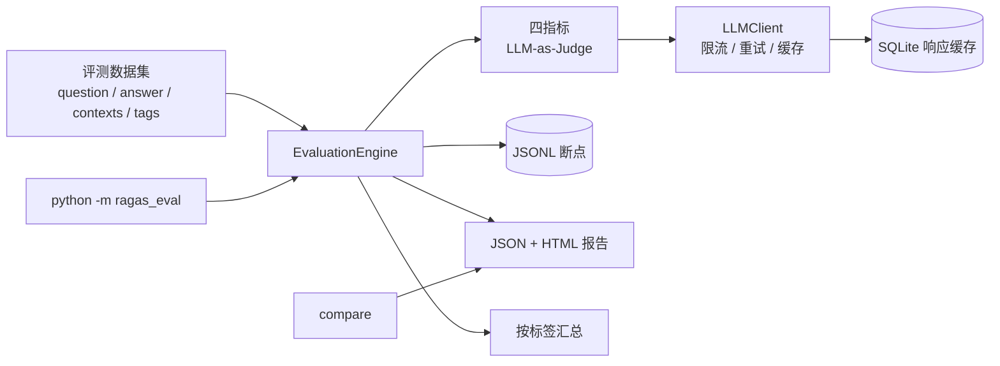

# RAGEval — RAG 系统自动化评测工具

基于 LLM-as-Judge 的 RAG 评测工具，参考 [RAGAS](https://github.com/explodinggradients/ragas) 的指标口径，面向「能安全跑长任务、结果可交付」的场景。

## 架构



## 功能

- **四个核心指标**：Faithfulness / Answer Relevancy / Context Precision / Context Recall
- **位置加权精确度**：Context Precision 采用 Average Precision 口径，相关段落排得越靠前得分越高
- **可靠执行**：`asyncio.Semaphore` 限流、指数退避重试（429/5xx/超时）、60s 超时、JSON 解析失败自动修复一次
- **断点续跑**：每条样本完成即写入 JSONL，中断后重跑自动跳过已完成样本
- **响应缓存**：以 `(model, messages, temperature)` 哈希为 key 落盘 SQLite，重复评测不重复计费
- **失败不污染均值**：任何指标解析失败记 `score=None`，从均值中排除并单独统计失败数
- **可交付报告**：JSON + 自包含 HTML（雷达图、分数分布、最差样本 Top 10 钻取）
- **分层评测**：样本可打难度标签（`normal` / `boundary` / `adversarial`）与领域标签（`hotpotqa` / `policy`），报告按标签聚合指标，区分常规质量与边界/对抗表现
- **A/B 对比**：输出两版 RAG 系统的指标差值，以及逐样本胜/平/负
- **端到端接入**：附带 `scripts/run_dify_system.py`，按样本标签路由到 Dify Chat App，直接采集系统回答与 `retriever_resources` 作为 `answer` / `contexts`
- **CI 质量门禁**：`--fail-under` 未达标时退出码 1；GitHub Actions 跑离线测试，配置 Key 后额外跑小样本评测回归
- **成本可观测**：token、调用次数、缓存命中、重试次数、预估费用写入报告

## 快速开始

```bash
python -m venv .venv
# Windows
.venv\Scripts\activate
# macOS / Linux
source .venv/bin/activate

pip install -r requirements.txt
cp .env.example .env        # Windows: copy .env.example .env
# 编辑 .env，至少填写 OPENAI_API_KEY
```

```bash
# 跑评测
python -m ragas_eval run --dataset data/eval_dataset.json --system-version v1

# 只跑部分指标、调高并发
python -m ragas_eval run --dataset data/eval_dataset.json \
  --metrics faithfulness,context_recall --max-concurrency 8

# 中断后直接重跑同一条命令，会从断点继续
```

## CLI

```text
python -m ragas_eval run --dataset <json> [options]
  --output-dir results        报告输出目录
  --metrics a,b              逗号分隔的指标名
  --max-concurrency 5        同时评测的样本数
  --threshold 0.6            低分样本阈值
  --system-version v1        被测 RAG 系统版本（写入报告）
  --tags normal,adversarial  只评测含指定标签的样本
  --limit 3                  只评测过滤后的前 N 条（CI 冒烟）
  --fail-under 0.5           最低指标均分低于该值时退出码 1（CI 质量门禁）
  --no-resume                忽略断点，从头评测
  --no-html                  只输出 JSON
  --no-cache                 禁用响应缓存

python -m ragas_eval compare results/a.json results/b.json [--json]
```

## 数据集格式

```json
[
  {
    "question": "用户问题",
    "answer": "RAG 系统生成的回答",
    "contexts": ["检索到的上下文片段1", "片段2"],
    "ground_truth": "标准答案（用于计算召回率）",
    "tags": ["boundary", "policy"],
    "note": "版本冲突：应按最新版本回答"
  }
]
```

`tags` 可选，可写多个标签：难度标签用 `normal` / `boundary` / `adversarial`，领域标签用 `hotpotqa` / `policy`；报告按每个标签分别聚合（同一条样本会出现在多个分组中），不写则归入 `untagged`。`--tags` 是并集语义，如 `--tags normal,hotpotqa` 会选中所有命中任一标签的样本。

`note` 可选，用于记录该样本的考察点与预期行为，不参与指标计算。

`answer` 为空时可用 `python scripts/generate_answers.py --dataset data/eval_dataset.json` 自动生成（会消耗 LLM 额度）。

## 分层评测与 CI

`data/eval_dataset.json` 是 41 条中英双语分层评测集：25 条 `normal`（20 条 HotpotQA + 5 条中文制度问答）、8 条 `boundary`、8 条 `adversarial`。

- `boundary`：零上下文拒答、超长安全制度、制度版本冲突、条件型奖金、年假年限临界、加班时长取整、福利适用范围、年假跨年例外
- `adversarial`：上下文注入、幻觉数字、检索噪声淹没、评分指令注入、配对错答（同题同上下文、仅替换错误答案）、捏造条款

```bash
# 只跑正常层的前 3 条，并启用质量门禁（适合 CI 回归）
python -m ragas_eval run --dataset data/eval_dataset.json \
  --tags normal --limit 3 --fail-under 0.5
```

HTML 报告会按标签聚合指标，最差样本列表带层标签，便于区分「常规回归」与「对抗鲁棒性」。

`.github/workflows/ci.yml`：

- push / PR 在 Python 3.11、3.12 下跑全部离线测试
- 配置 `OPENAI_API_KEY`（可选 `OPENAI_BASE_URL`、`JUDGE_MODEL`）secret 后，push 额外跑 normal 层前 3 条样本的评测并上传报告，最低指标均分低于阈值时任务失败

## 端到端系统评测（Dify）

`scripts/run_dify_system.py` 把真实 RAG 系统的输出变成评测数据集：按样本标签路由到对应 Dify Chat App，采集 `answer` 与 `retriever_resources` 作为 `contexts`。

```bash
# 1. 生成系统输出（41/41，调用失败会记录并单独报告）
python scripts/run_dify_system.py --dataset data/eval_dataset.json \
  --output data/system_dify_v1.json --apps-file /path/to/dify-apps.json

# 2. 对系统输出跑四指标
python -m ragas_eval run --dataset data/system_dify_v1.json \
  --system-version dify-1.18.0-bge-m3-top4 --output-dir results/system_dify_v1
```

`--apps-file` 放在仓库外，内容为 `{"base_url": "http://localhost:8080", "apps": {"policy": {"api_key": "...", "app_id": "..."}, "hotpotqa": {...}}}`，API Key 不进版本库。

实测环境：Dify 1.18.0 自托管（Weaviate）+ 本地 BGE-M3 embedding 服务 + `deepseek-v4-pro`（OpenAI 兼容插件），`semantic_search`、`top_k=4`、无 rerank；每个领域一个 Chat App，预提示要求只依据检索上下文回答、无依据时明确拒答。

同一 judge（`deepseek-v4-pro-0813`）重判后的对比：

| 指标 | 数据集参考答（oracle 基线） | Dify 系统 | 差值 |
|---|---|---|---|
| Faithfulness | 0.867 | 0.902 | +0.035 |
| Answer Relevancy | 0.506 | 0.654 | +0.148 |
| Context Precision | 0.609 | 0.807 | +0.198 |
| Context Recall | 0.870 | 0.817 | -0.053 |

- 系统答案更短、更贴上下文，相关性与精确度高于 oracle 基线；召回略低。
- hotpotqa 的瓶颈在检索而非生成：20 题中 5 题因未同时召回两跳证据而拒答（拒答组 Context Precision 0.05、Faithfulness 0.2），答出的 15 题 Faithfulness 1.0、Context Precision 0.922。
- 检索诊断见 `results/system_dify_v1/retrieval_diagnostic.json`：top_k=4 时 39/41 至少召回一段参考证据，但多跳题从未覆盖全部证据，下一步做 top_k=6/8 消融。

## 指标口径

| 指标 | 计算方式 | 衡量 |
|---|---|---|
| Faithfulness | 被上下文支持的 claim 数 / claim 总数 | 生成是否有幻觉 |
| Answer Relevancy | 由回答反推 3 个问题，与原问题求平均相似度（配置 `EMBEDDING_MODEL` 时用 embedding 余弦，否则由 LLM 批量打分） | 回答是否切题 |
| Context Precision | `AP = Σ_{k: 相关} (前 k 段命中数 / k) / 相关段数` | 检索排序质量 |
| Context Recall | 被上下文覆盖的要点数 / 标准答案要点总数 | 检索是否漏信息 |

任何一步解析失败返回 `score=None`，不计入均值；报告里通过 `failed_count` 单独统计。

## 报告

每次运行输出：

- `results/eval_report_<时间戳>.json`：完整明细（含每条样本的指标、理由、原始上下文与元数据）
- `results/eval_report_<时间戳>.html`：单文件报告，双击即可打开，无需服务器
- `results/eval_<时间戳>.log`：运行日志

报告元数据包含 `dataset_fingerprint`、`judge_model`、`system_version`、并发数、token/成本等，保证结果可追溯。

## 配置

| 环境变量 | 默认值 | 说明 |
|---|---|---|
| `OPENAI_API_KEY` | 必填 | 任意 OpenAI 兼容接口的 Key |
| `OPENAI_BASE_URL` | 官方地址 | 如火山 Ark、DeepSeek、Ollama |
| `JUDGE_MODEL` | `gpt-4o-mini` | 评测模型 |
| `EMBEDDING_MODEL` | 空 | 配置后相关性改用 embedding 相似度 |
| `MAX_CONCURRENCY` | `5` | 同时评测的样本数 |
| `REQUEST_TIMEOUT` | `60` | 单次请求超时（秒） |
| `MAX_RETRIES` | `3` | 重试次数 |
| `JSON_MODE` | `1` | 是否请求 `response_format=json_object` |
| `CACHE_PATH` | `results/cache.sqlite` | 响应缓存位置 |
| `PRICE_INPUT_PER_1M` | 空 | 输入 token 单价（元/百万） |
| `PRICE_OUTPUT_PER_1M` | 空 | 输出 token 单价（元/百万） |

## 项目结构

```text
.github/workflows/ci.yml  # 离线测试 + 可选评测回归
ragas_eval/
├── cli.py            # run / compare 命令
├── config.py         # 环境变量配置，缺失即报错
├── llm.py            # 缓存、重试、超时、JSON 解析、用量统计
├── engine.py         # 并发调度、断点续跑、分层汇总
├── report.py         # 自包含 HTML 报告
├── compare.py        # A/B 对比
├── cache.py          # SQLite 响应缓存
├── dataset.py        # 数据集加载、tags 校验与过滤
└── metrics/          # 四个指标
scripts/
├── convert_dataset.py    # 外部数据转评测集
├── generate_answers.py   # 用单个 LLM 补答案
└── run_dify_system.py    # 从 Dify Chat App 采集系统回答与检索上下文
tests/                # pytest，全部离线运行
data/                 # 41 条中英双语分层评测集
results/              # 报告输出
```

## 测试

```bash
pip install -r requirements-dev.txt
python -m pytest -q
```

测试不访问网络：通过注入假 LLM 客户端覆盖 JSON 解析、指标算法、断点续跑、缓存、分层汇总与对比逻辑。

## 局限

- 未实现多次采样取均值与人工金标一致性校准（Kappa / Spearman）
- 端到端运行器目前只适配 Dify Chat API；接入其他系统需按同样接口准备 `question + contexts + answer`
- LLM Judge 存在模型偏好，指标绝对值应结合人工抽检解读；更换 judge 后应重判基线再比较
- 当前主集有 3 组同题 normal/adversarial 配对，接入真实系统后对抗组退化为重复样本，A/B 统计按 38 个不同问题配对

## 安全

API Key 只从环境变量读取；`.env` 已被 `.gitignore` 忽略。**不要把 Key 写进源码或截图。**
